# Modul 6 - IGA: tilgangspakker og tilgangsgjennomganger

**Behov:** I Fjordvik ble ekstra tilgang gitt manuelt og aldri fjernet. Ingen kontrollerte jevnlig hvem som hadde tilgang til hva.

**Løsning:** Tilgang til lønnsrapporter styres med en tilgangspakke og en kvartalsvis tilgangsgjennomgang:

1. **Tilgangspakke:** Ansatte ber selv om tilgang, HR-leder godkjenner, og tilgangen utløper automatisk etter 90 dager.
2. **Tilgangsgjennomgang:** HR-leder bekrefter hvert kvartal hvem som fortsatt skal ha tilgang. Den som avslås, mister tilgangen automatisk.

Scenario: Ola Hav i Salg trenger lesetilgang til lønnsrapporter for et prosjekt. Kari Nilsen (HR-leder) eier rapportene.

## Oppsett

### 1. Gruppe og katalog

Opprettet gruppen `GRP-Lonnsrapporter-Les` med statisk medlemskap og ingen medlemmer. Alle medlemmer skal komme gjennom tilgangspakken. Gruppen er lagt i katalogen *Fjordvik HR*, som samler ressursene HR eier.

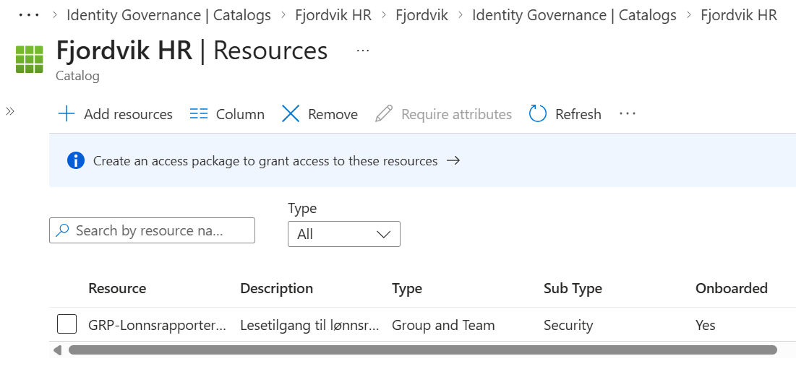

### 2. Tilgangspakke

| Innstilling | Verdi |
|---|---|
| Navn | Lønnsrapporter - Lesetilgang |
| Gir | Medlemskap i GRP-Lonnsrapporter-Les |
| Hvem kan be om tilgang | Alle ansatte (ikke gjester) |
| Godkjenner | Kari Nilsen (HR-leder) |
| Begrunnelse | Kreves fra både den som ber om tilgang og godkjenner |
| Utløper | Etter 90 dager |

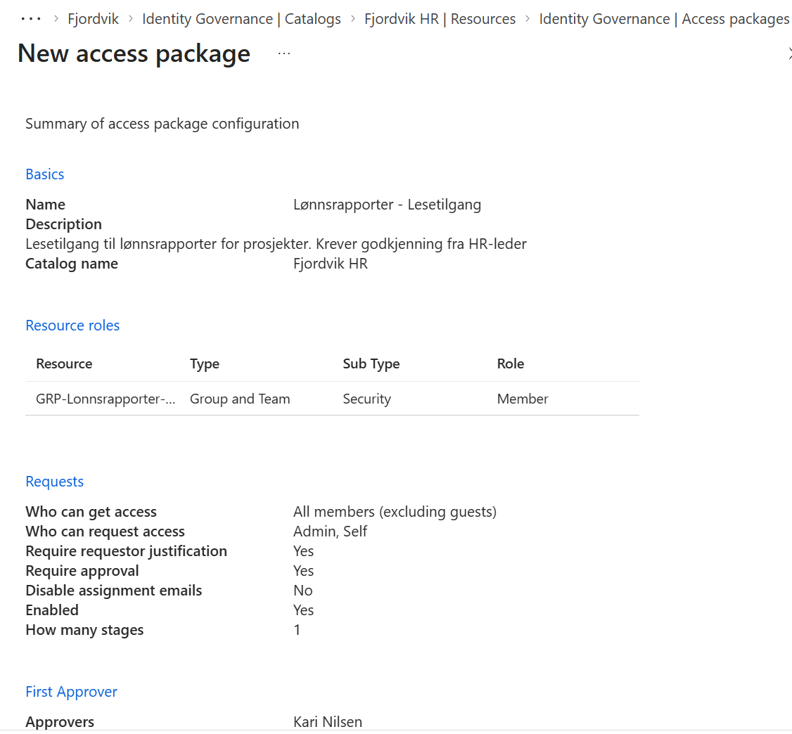

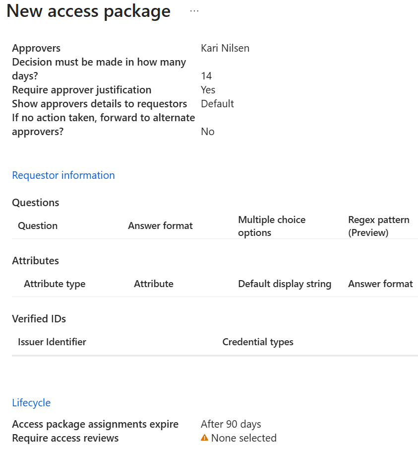

### 3. Tilgangsgjennomgang

| Innstilling | Verdi |
|---|---|
| Gjelder | Alle medlemmer av GRP-Lonnsrapporter-Les |
| Kontrollør | Kari Nilsen |
| Hyppighet | Kvartalsvis |
| Resultat | Brukes automatisk på gruppen |
| Hvis kontrolløren ikke svarer | Tilgangen fjernes |
| Beslutningshjelp | Anbefaler å avslå brukere uten innlogging de siste 30 dagene |

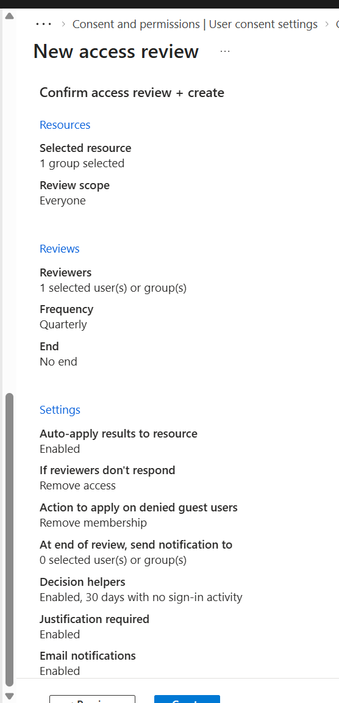

## Test: hele livsløpet til en tilgang

| # | Steg | Utført av | Resultat |
|---|---|---|---|
| 1 | Ola ber om tilgang med begrunnelse | Ola (selvbetjening i My Access) | Forespørsel sendt til Kari |
| 2 | Kari godkjenner med begrunnelse | Kari | Ola lagt til i gruppen |
| 3 | Kari avslår Ola i tilgangsgjennomgangen | Kari | Ola fjernet fra gruppen |

**Steg 1:** Ola ber om tilgangspakken i My Access og oppgir hvorfor han trenger den.

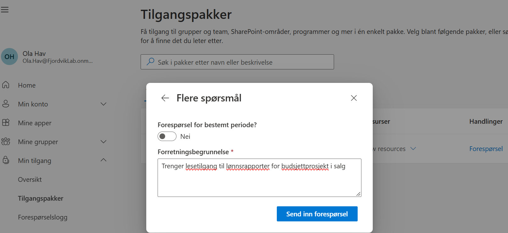

**Steg 2:** Kari godkjenner forespørselen. Ola blir lagt til i gruppen automatisk.

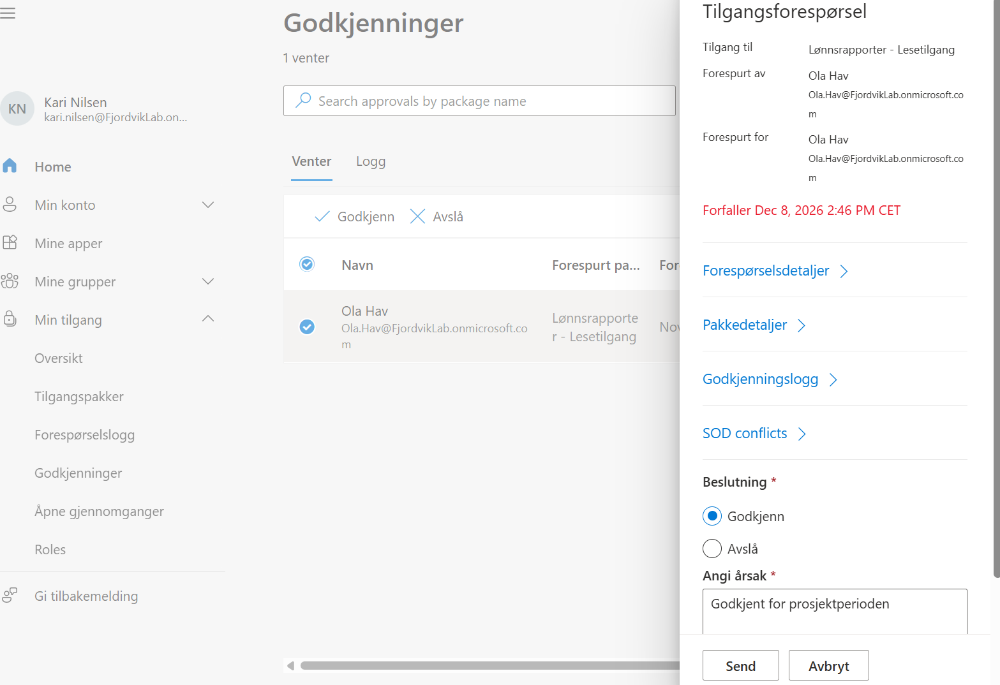

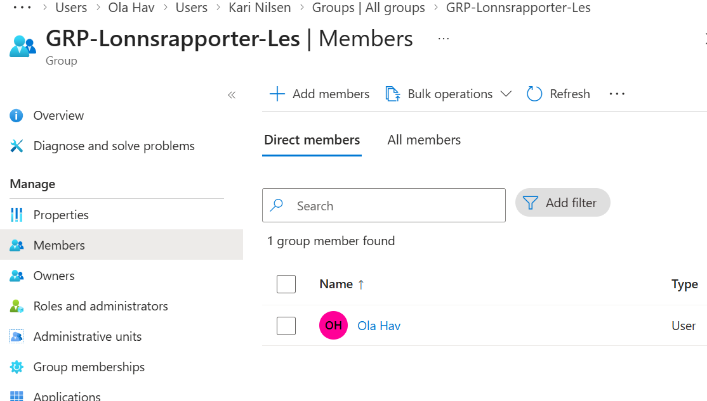

**Steg 3:** Prosjektet er avsluttet. I tilgangsgjennomgangen avslår Kari Ola. Beslutningshjelpen anbefalte også å avslå.

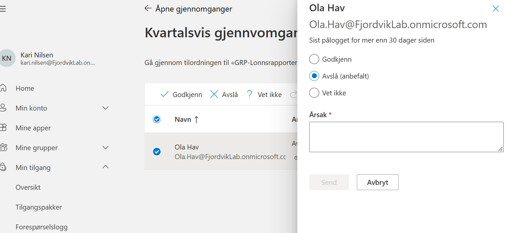

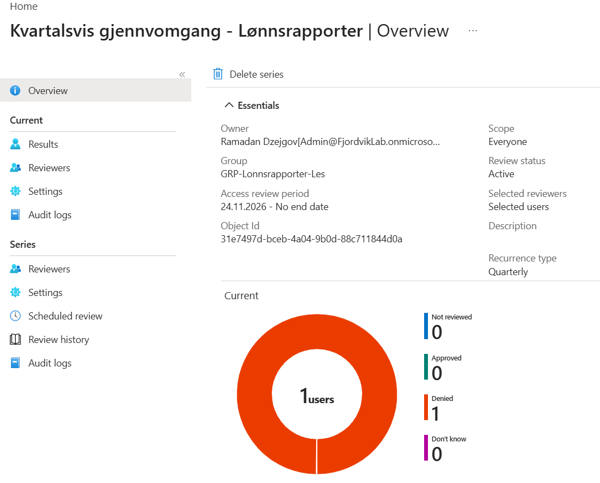

Gjennomgangen ble stoppet manuelt for å bruke resultatet med en gang, og Ola ble fjernet fra gruppen.

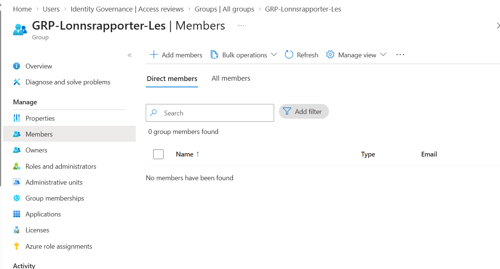

## Sporbarhet

Audit logs for gruppen viser at ingen administrator endret medlemskapet manuelt. Ola ble lagt til av Identity Governance (tilgangspakken) etter Karis godkjenning, og fjernet av tilgangsgjennomgangen etter Karis avslag.

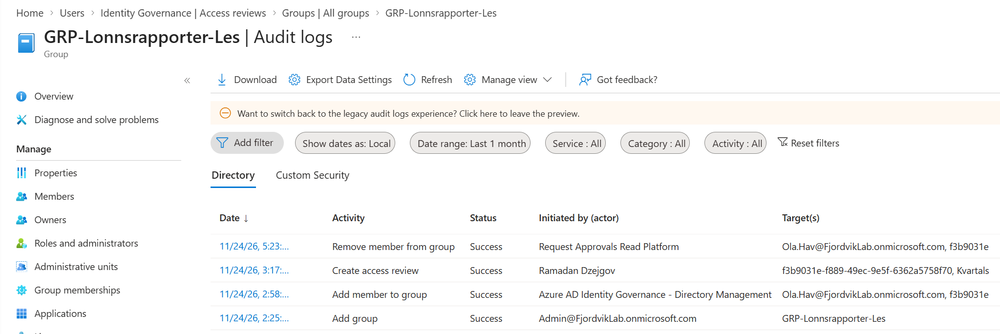

## Funn

**Fjerningen tok rundt to timer.** Etter at gjennomgangen ble stoppet, sto den på *Applying* i omtrent to timer før Ola ble fjernet. Resultatet av en tilgangsgjennomgang er altså ikke umiddelbart. Hvis tilgang må fjernes med en gang, for eksempel ved en sikkerhetshendelse, må det gjøres manuelt.

**Beslutningshjelpen tok feil.** Den anbefalte å avslå Ola fordi han ikke hadde logget inn de siste 30 dagene, selv om han logget inn samme dag. Aktivitetsdata oppdateres med forsinkelse. Anbefalingen er bare et forslag, og kontrolløren må ta beslutningen selv.

## Begrensninger

- Gjennomgangen er satt opp på gruppen, mens Ola fikk tilgang gjennom tilgangspakken. Tildelingen i tilgangspakken kan fortsatt gjelde selv om gruppemedlemskapet er fjernet. Microsoft anbefaler å gjennomgå selve tilgangspakken når tilgang gis gjennom pakker.
- Rollekonflikter (Segregation of Duties) er ikke satt opp. En naturlig utvidelse er å hindre at samme person har både "betale fakturaer" og "godkjenne fakturaer".
- Gruppen representerer tilgang til lønnsrapporter, men er ikke koblet til et ekte system i labben.
