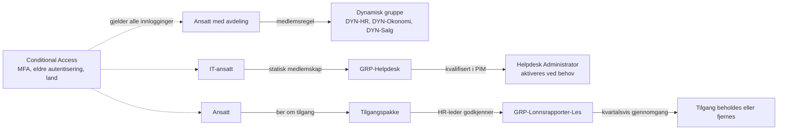

# Fjordvik IAM Lab - Microsoft Entra ID

IAM-lab i Microsoft Entra ID for det fiktive logistikkfirmaet Fjordvik AS. Labben dekker rollebasert og attributtbasert tilgang, livsløpet til ansatte, Conditional Access, Privileged Identity Management og tilgangsstyring, med tester og bevis fra loggene.

| Testbrukere | Grupper | Conditional Access-policyer | PIM-roller | Tilgangspakker | Identity Secure Score |
|---|---|---|---|---|---|
| 8 | 5 | 3 | 1 | 1 | 52,50 % til 53,37 % |

## Scenario

Fjordvik AS har vokst fort, og IT har gitt tilganger manuelt. En revisjon fant seks problemer. Hver modul i labben løser ett eller flere av dem.

| Problem hos Fjordvik | Løsning | Modul |
|---|---|---|
| IT ga tilgang til en og en person | Admin-rolle tildelt en gruppe i stedet for enkeltpersoner | [1 - RBAC](modul%201%20-%20RBAC/) |
| Ansatte beholdt gammel tilgang når de byttet avdeling | Dynamiske grupper basert på attributtet *department* | [2 - ABAC](modul%202%20-%20ABAC/) |
| Kontoer virket etter at ansatte hadde sluttet | Rutine for joiner, mover og leaver, og medlemsregler som krever aktiv konto | [3 - JML](modul%203%20-%20JML/) |
| Innlogging krevde bare passord | Conditional Access: MFA, blokkering av eldre autentisering og innlogging utenfor Norge | [4 - Conditional Access](modul%204%20-%20Conditional%20Access/) |
| IT-ansatte var administratorer hele tiden | Just-in-time-tilgang med PIM: aktivering med MFA og begrunnelse, maks en time | [5 - PIM](modul%205%20-%20PIM/) |
| Ingen kontrollerte hvem som hadde tilgang til hva | Tilgangspakke med godkjenning og utløp, og kvartalsvis tilgangsgjennomgang | [6 - IGA](modul%206%20-%20IGA/) |

## Slik henger det sammen

## Hver modul er dokumentert likt

1. **Behov:** hva Fjordvik trengte
2. **Oppsett:** hva som ble konfigurert
3. **Tester:** både at tilgang virker og at den blir avvist
4. **Bevis:** skjermbilder fra Audit logs, Sign-in logs eller PIM
5. **Funn og begrensninger:** hva som ikke gikk som forventet, og hva løsningen ikke dekker

## Viktigste funn

| Modul | Funn |
|---|---|
| 3 | Deaktiverte brukere ble værende i dynamiske grupper. Løst ved å legge til `accountEnabled -eq true` i medlemsreglene. |
| 4 | Report-only viste at en policy ville blokkert brukere i Norge, fordi en ny plassering ikke var tatt i bruk ennå. Policyen ble ikke slått på før en ny test viste riktig resultat. |
| 4 | Nødkontoen koster poeng i Secure Score, fordi den er unntatt fra MFA. Det er et bevisst valg for å unngå å låse ute alle administratorer. |
| 6 | Resultatet av en tilgangsgjennomgang tok rundt to timer å bruke. Tilgang som må fjernes med en gang, må fjernes manuelt. |

## Hva jeg lærte

- Tilgang bør styres gjennom grupper, roller og attributter, ikke tildeles direkte til personer.
- Hver endring bør testes både for at den gir tilgang og for at den stopper tilgang, og bekreftes i loggene.
- Endringer i Entra ID trer ikke alltid i kraft med en gang. Report-only og ny testing hindrer feil i produksjon.
- Sikkerhet handler om avveininger. En nødkonto svekker poengsummen, men hindrer at organisasjonen låser seg ute.

## Begrensninger

- Labben er bygget med testbrukere i en egen tenant, ikke i et produksjonsmiljø.
- Microsoft Entra ID P2 ble brukt.
- Gruppene representerer tilgang til systemer, men er ikke koblet til ekte applikasjoner.
- Brukere er opprettet manuelt. I en ekte bedrift kommer de fra et HR-system.

## Verktøy

Microsoft Entra ID P2, Entra admin center, Conditional Access, Privileged Identity Management, Entitlement management (tilgangspakker), Access reviews og My Access.
