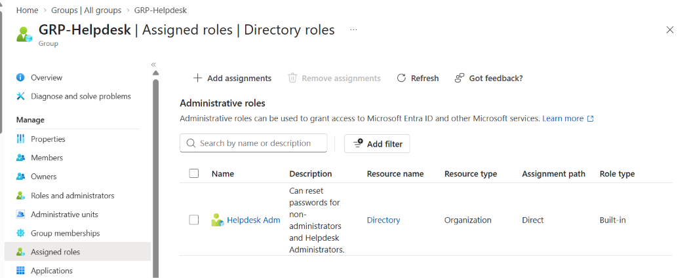
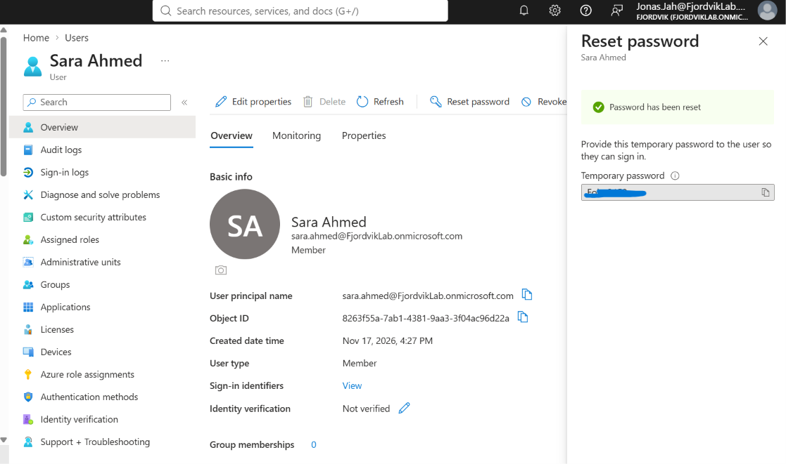
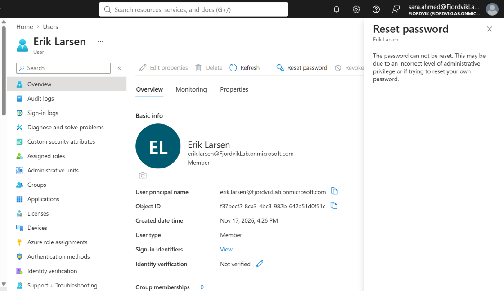
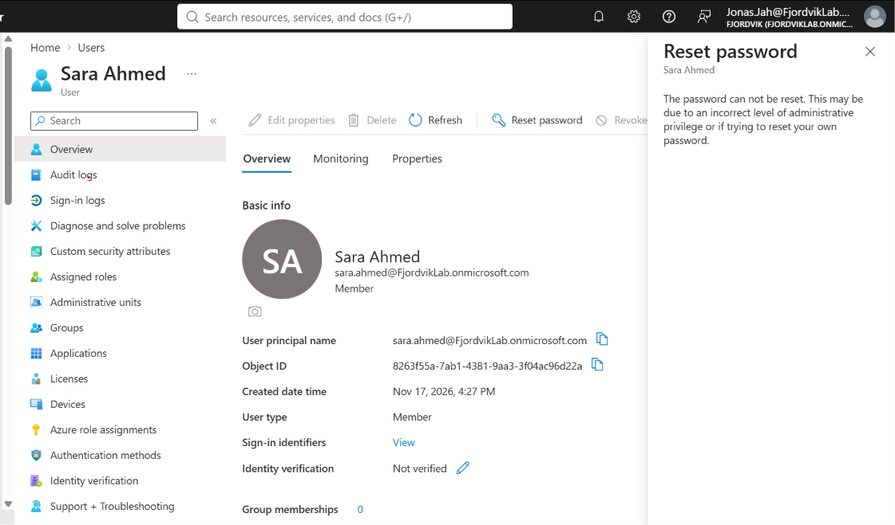
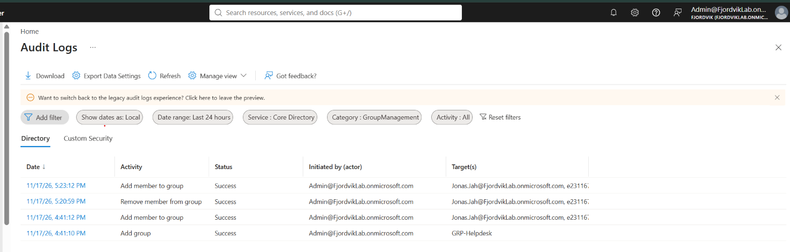

# Modul 1 – RBAC: tilgang via grupper

**Behov:** IT i Fjordvik tildelte admin-rettigheter direkte til enkeltpersoner. Det gir feil og dårlig oversikt over hvem som har hvilke rettigheter.

**Løsning:** Rollen **Helpdesk Administrator** er tildelt gruppen `GRP-Helpdesk` i stedet for enkeltpersoner. Medlemskap i gruppen styrer hvem som har rollen.

## Oppsett

1. Opprettet sikkerhetsgruppen `GRP-Helpdesk` som rolletildelbar gruppe (*Microsoft Entra roles can be assigned to the group* = Yes)
2. Tildelte gruppen rollen Helpdesk Administrator
3. La til Jonas Jah (IT-ansvarlig) som medlem

## Tester

| # | Bruker | Handling | Forventet | Resultat |
|---|---|---|---|---|
| 1 | Jonas (medlem) | Tilbakestille passordet til Sara | Tillatt | Tillatt |
| 2 | Sara (ikke medlem) | Tilbakestille passordet til Erik | Avvist | Avvist |
| 3 | Jonas (fjernet fra gruppen) | Tilbakestille passordet til Sara | Avvist | Avvist |

**Test 1:** Jonas er medlem og får tilbakestille passordet. Det midlertidige passordet er sladdet.

**Test 2:** Sara er ikke medlem og blir avvist.

**Test 3:** Etter at Jonas ble fjernet fra gruppen, mistet han rettigheten med en gang. Han ble lagt til igjen etter testen.

## Sporbarhet

Audit logs viser at gruppen ble opprettet, og når Jonas ble lagt til, fjernet og lagt til igjen. Alle endringene er utført av Admin.

## Begrensninger

- Rollen gjelder hele tenanten, ikke bare en avdeling. Kan avgrenses med administrative enheter.
- Jonas har rollen permanent. Bør gjøres om til tidsbegrenset tilgang med PIM (modul 5).
