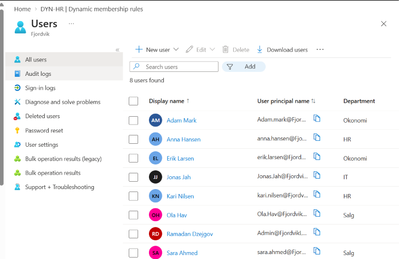
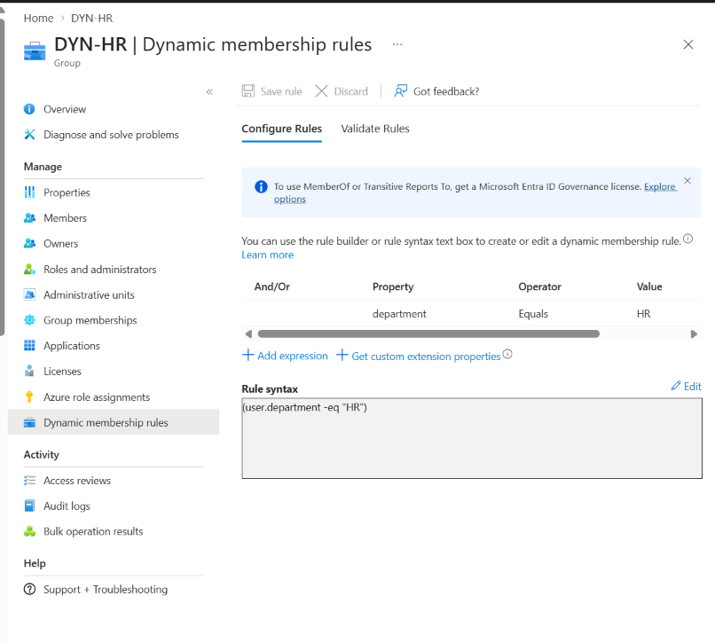
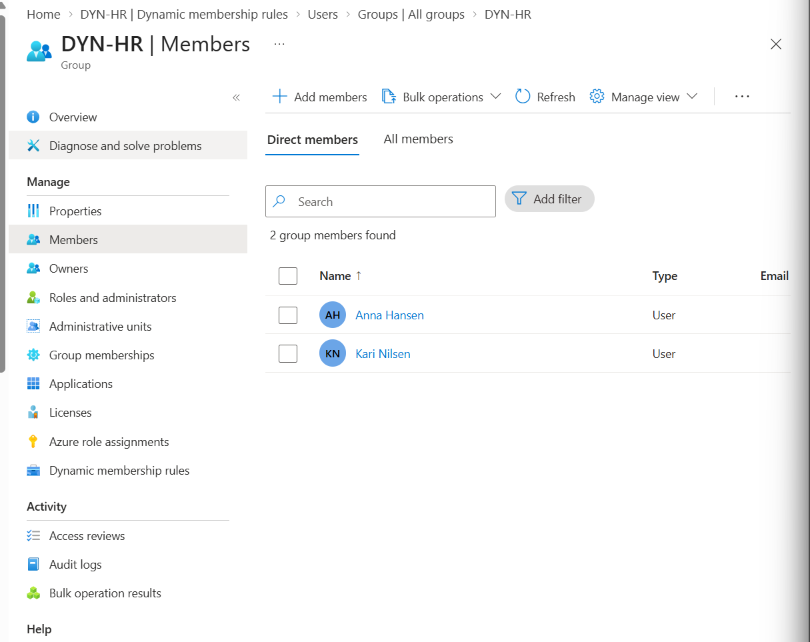
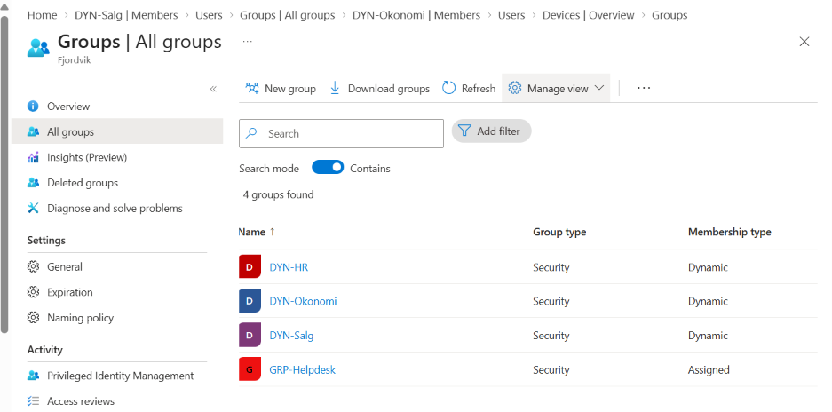
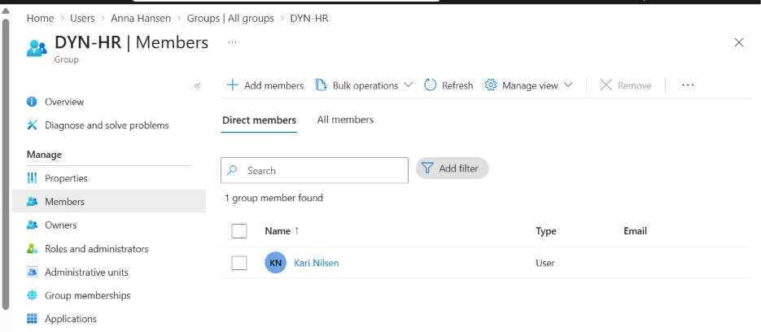
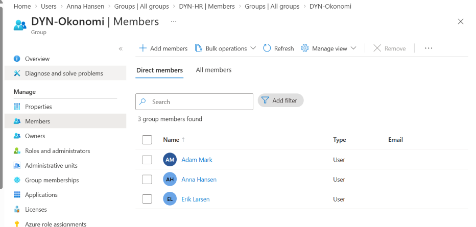
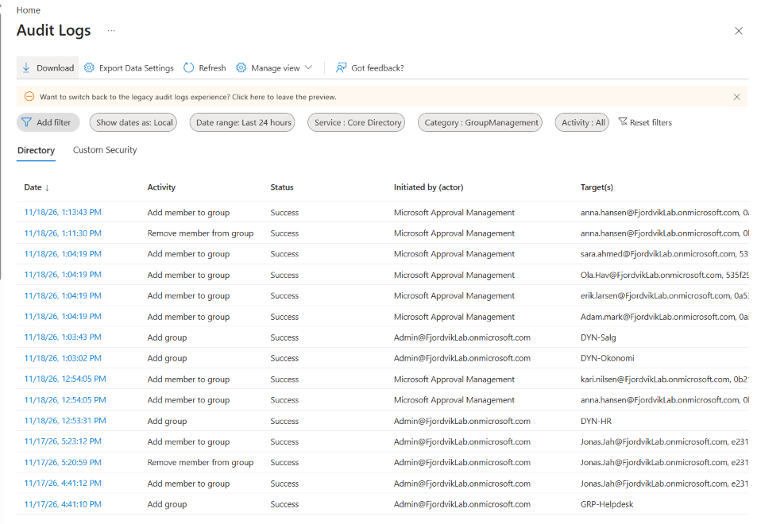

# Modul 2 – ABAC: tilgang ut fra avdeling

**Behov:** Ansatte i Fjordvik beholdt gammel tilgang når de byttet avdeling, fordi ingen husket å flytte dem mellom grupper.

**Løsning:** Dynamiske grupper med medlemsregler basert på attributtet *department*. Når avdelingen på en bruker endres, flytter Entra brukeren til riktig gruppe automatisk.

## Oppsett

1. Satte attributtet *department* på alle ansatte (HR, Okonomi, Salg og IT)

2. Opprettet tre sikkerhetsgrupper med dynamisk medlemskap:

| Gruppe | Medlemsregel |
|---|---|
| `DYN-HR` | `(user.department -eq "HR")` |
| `DYN-Okonomi` | `(user.department -eq "Okonomi")` |
| `DYN-Salg` | `(user.department -eq "Salg")` |

3. Regelen fylte gruppene automatisk. DYN-HR fikk Anna og Kari uten at de ble lagt til manuelt.

4. Navnestandard: `DYN-` for dynamiske grupper og `GRP-` for grupper med statisk medlemskap. `GRP-Helpdesk` fra modul 1 har fortsatt statisk medlemskap, fordi tildeling av admin-roller bør styres manuelt.

## Test: Anna bytter fra HR til Okonomi

Jeg endret bare attributtet *department* på Anna Hansen fra `HR` til `Okonomi`. Gruppene ble ikke endret.

| Gruppe | Før | Etter |
|---|---|---|
| `DYN-HR` | Anna, Kari | Kari |
| `DYN-Okonomi` | Erik, Adam | Erik, Adam, Anna |

**Etter:** Anna er fjernet fra DYN-HR og lagt til i DYN-Okonomi, innen få minutter.

## Sporbarhet

Audit logs viser forskjellen på statisk og dynamisk medlemskap. Gruppene er opprettet av Admin, men alle endringer i medlemskap i de dynamiske gruppene er utført av *Microsoft Approval Management*, altså av medlemsregelen. I modul 1 er medlemskapet i GRP-Helpdesk endret manuelt av Admin.

## Begrensninger

- Medlemsreglene er bare så gode som attributtene. Feil eller ulik stavemåte (for eksempel `Økonomi` i stedet for `Okonomi`) gjør at brukeren havner utenfor gruppen. I en ekte bedrift bør attributtene komme fra HR-systemet.
- Gruppene gir ennå ikke tilgang til noe system. De brukes videre i modul 6 (tilgangspakker og tilgangsgjennomganger).
- Endringen tar noen minutter. Tilgangen fjernes altså ikke i samme sekund som avdelingen endres.
