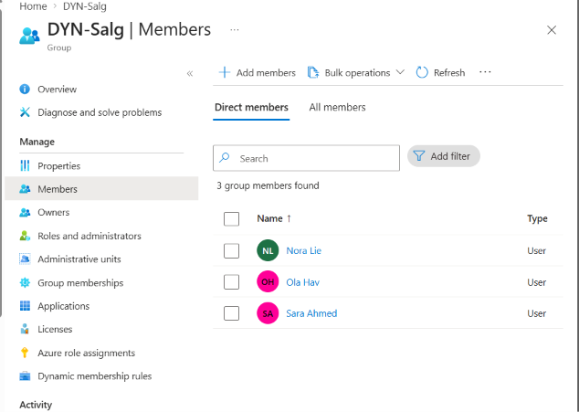
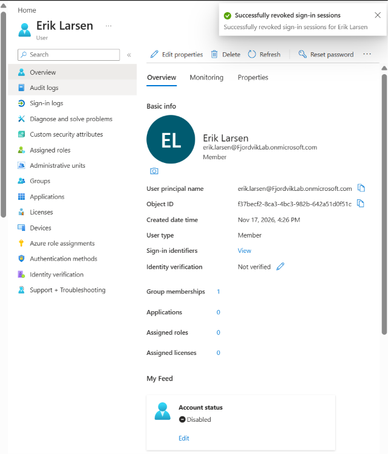
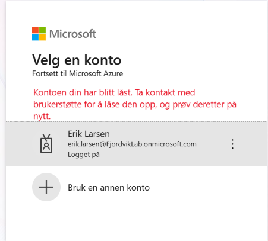
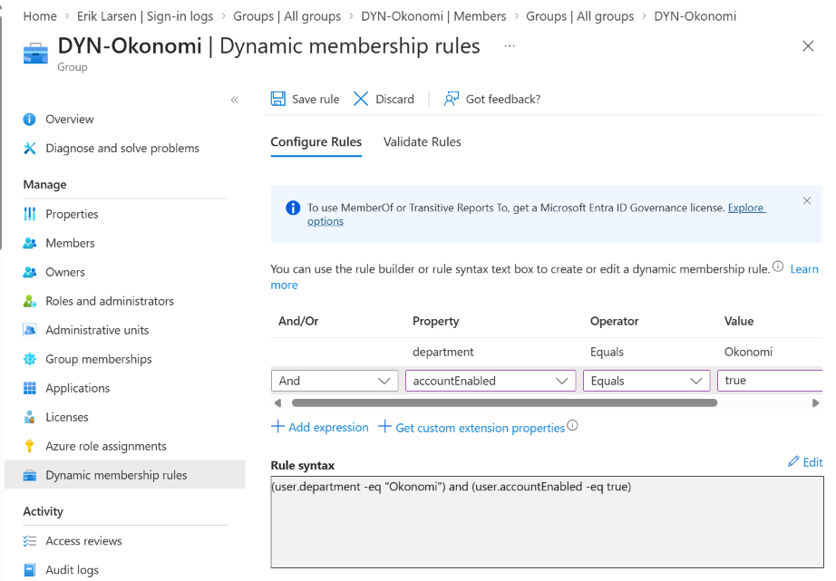
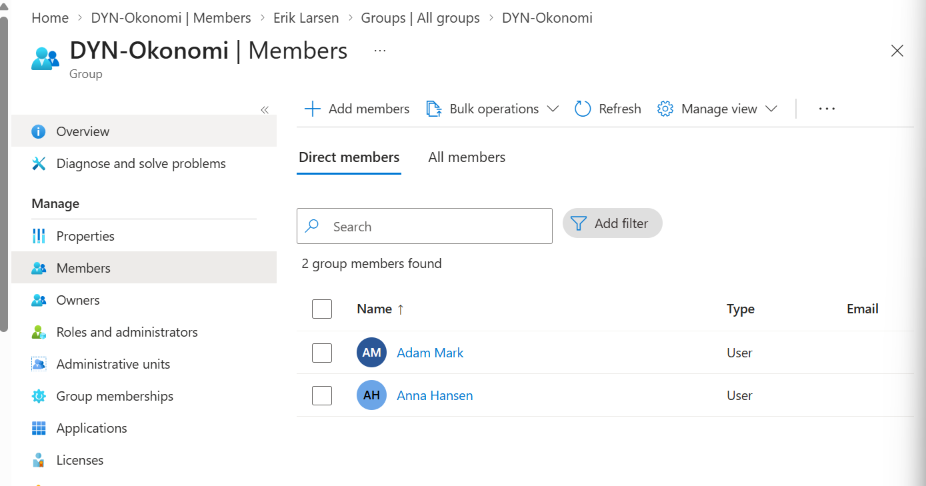

# Modul 3 – Joiner, Mover, Leaver

**Behov:** I Fjordvik hadde ansatte som sluttet fortsatt kontoer som virket, og nye ansatte måtte vente på at noen ga dem tilgang.

**Løsning:** Livsløpet til en ansatt håndteres med attributter og dynamiske grupper. En ny ansatt får riktig tilgang fra første dag, og en som slutter blir deaktivert og mister gruppemedlemskapene sine.

| Fase | Eksempel | Hvordan |
|---|---|---|
| Joiner | Nora Lie begynner i Salg | Opprettet med *department* = Salg, havner automatisk i DYN-Salg |
| Mover | Anna Hansen bytter fra HR til Okonomi | Vist i [modul 2](../modul-2-abac/) |
| Leaver | Erik Larsen slutter | Kontoen deaktiveres og øktene trekkes tilbake |

## Joiner: Nora Lie begynner i Salg

Nora ble opprettet med avdeling Salg. Hun ble lagt til i DYN-Salg av medlemsregelen, uten manuell tildeling.



## Leaver: Erik Larsen slutter

1. Deaktiverte kontoen (*Account enabled* = No)
2. Trakk tilbake alle aktive økter (*Revoke sessions*)



**Test:** Erik prøvde å logge inn med riktig passord og ble avvist fordi kontoen er låst.



## Funn og forbedring

**Hva jeg oppdaget:** Etter deaktiveringen var Erik fortsatt medlem av DYN-Okonomi. Medlemsregelen så bare på avdelingen, og den var fortsatt Okonomi.

**Hvorfor det er et problem:** Hvis kontoen ble aktivert igjen ved en feil, ville Erik fått all tidligere tilgang tilbake med en gang. Han ville også dukket opp i rapporter og tilgangsgjennomganger som om han fortsatt jobbet i Fjordvik.

**Løsning:** La til et krav om at kontoen må være aktiv i alle de dynamiske gruppene:

```
(user.department -eq "Okonomi") and (user.accountEnabled -eq true)
```



Erik ble fjernet fra DYN-Okonomi. Regelendringen ble ikke behandlet med en gang. Etter en endring på brukerobjektet ble Erik vurdert på nytt og fjernet innen få minutter.



## Rutine når en ansatt slutter

1. Deaktiver kontoen
2. Trekk tilbake aktive økter (*Revoke sessions*)
3. Fjern brukeren fra grupper med statisk medlemskap og fra admin-roller
4. Kontroller at brukeren er fjernet fra dynamiske grupper

## Begrensninger

- Endringer i medlemsregler kan ta lang tid å behandle. Deaktivering og *Revoke sessions* må derfor alltid gjøres manuelt først.
- *Revoke sessions* stopper nye innlogginger, men en åpen økt i en app kan vare til tilgangstokenet utløper (vanligvis 60–90 minutter).
- Joiner og leaver er gjort manuelt i portalen. I en ekte bedrift startes dette fra HR-systemet (se modul 7).
