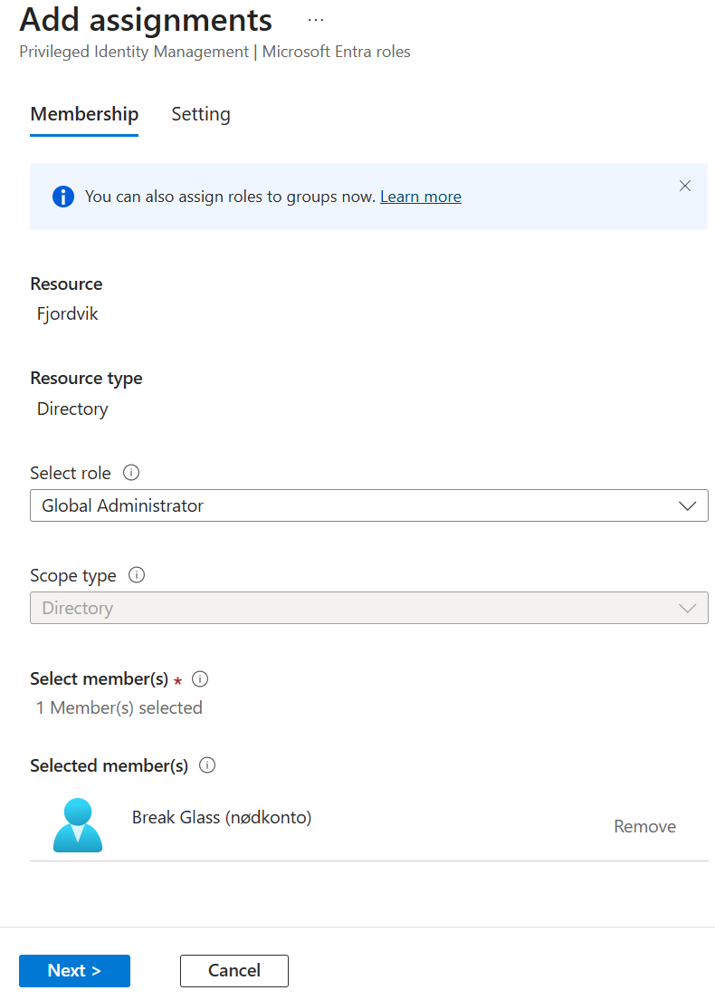
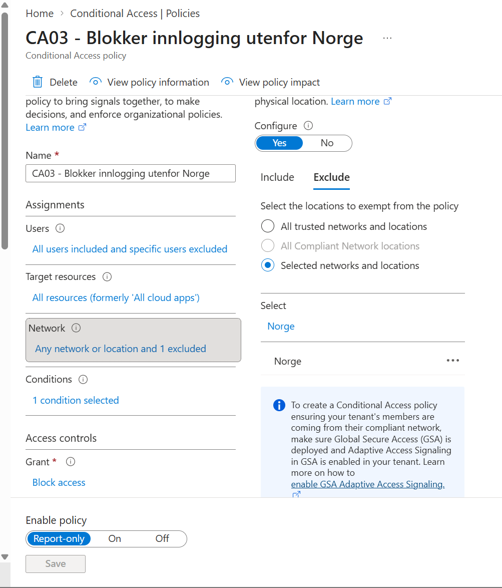
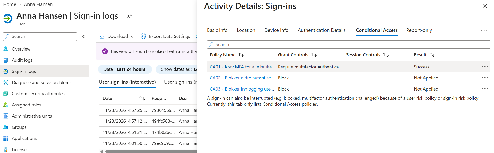
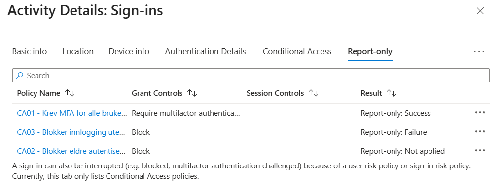

# Modul 4 - MFA og Conditional Access

**Behov:** Fjordvik brukte Security defaults, Microsofts ferdige grunnsikring. Den kan bare slås av eller på, og gir ingen mulighet for unntak, testing eller egne regler, for eksempel blokkering av innlogging fra utlandet.

**Løsning:** Security defaults er erstattet med tre Conditional Access-policyer. En egen nødkonto (break-glass) er unntatt fra alle policyene, slik at administratorer ikke kan låses ute. Alle policyene ble testet i report-only før de ble slått på.

Utgangspunkt før endringene: Identity Secure Score 52,50 %.

## Oppsett

### 1. Nødkonto (break-glass)

Opprettet kontoen *Break Glass (nødkonto)* med permanent, aktiv tildeling av Global Administrator. Kontoen er unntatt fra alle Conditional Access-policyer og skal bare brukes i nødstilfeller.

### 2. Policyer

| Policy | Gjelder | Krav | Unntak |
|---|---|---|---|
| CA01 - Krev MFA for alle brukere | Alle brukere, alle ressurser | MFA | Nødkonto |
| CA02 - Blokker eldre autentisering | Alle brukere, eldre klienter (Exchange ActiveSync og andre) | Blokker | Nødkonto |
| CA03 - Blokker innlogging utenfor Norge | Alle brukere, alle steder | Blokker | Nødkonto og plasseringen Norge |

Administratorkontoen er ikke unntatt fra policyene. Navnestandarden `CA01`, `CA02` og så videre gjør det lett å holde oversikt.

### 3. Report-only, deretter på

Alle policyene ble først satt til report-only, slik at de bare logget hva de ville gjort. Først når resultatet var riktig, ble de slått på.

## Tester

| # | Test | Forventet | Resultat |
|---|---|---|---|
| 1 | Anna logger inn fra Norge uten registrert MFA | Må sette opp MFA | Må sette opp MFA |
| 2 | Anna logger inn fra Norge | CA01 krever MFA, CA02 og CA03 gjelder ikke | Som forventet |
| 3 | Innlogging fra USA (What If, IP 8.8.8.8) | CA03 blokkerer | Blokkert |

**Test 1:** CA01 tvinger Anna til å sette opp MFA før hun slipper inn.

**Test 2:** Sign-in logs viser at CA01 ble håndhevet og at Anna bestod MFA. CA02 og CA03 ble ikke brukt.

**Test 3:** What If viser at en innlogging fra USA blokkeres av CA03.

## Funn og forbedring

**Funn 1: CA03 ville blokkert en bruker i Norge.** Den første testen i report-only viste at CA03 ville blokkert Adam, selv om loggen viste at han logget inn fra Norge. Plasseringen Norge og policyen var opprettet bare minutter før innloggingen, og unntaket var ikke tatt i bruk ennå. En ny test 20 minutter senere viste riktig resultat. Hadde policyen blitt slått på med en gang, kunne alle brukerne blitt låst ute.

**Lærdom:** Vent etter endringer i policyer og plasseringer, og test på nytt i report-only før policyen slås på.

**Funn 2: MFA ble krevd selv med policyene i report-only.** Microsoft krever alltid MFA ved innlogging på administrasjonsportalene (Azure- og Entra-portalen), uavhengig av egne policyer. For å teste egne policyer riktig ble testene gjort mot myaccount.microsoft.com.

## Begrensninger

- CA02 er ikke testet med en ekte eldre klient. Den er kontrollert gjennom konfigurasjonen og report-only.
- CA03 er testet med What If, ikke med en ekte innlogging fra utlandet.
- Nødkontoen er bare beskyttet av passordet sitt. Bruk av kontoen bør overvåkes med varsling.
- Security defaults ga allerede poeng for MFA i Secure Score, så endringen gir mer kontroll, men ikke et stort hopp i poengsummen.
