# Modul 4 - MFA og Conditional Access

**Behov:** Fjordvik brukte Security defaults, Microsofts ferdige grunnsikring. Den kan bare slås av eller på, og gir ingen mulighet for unntak, testing eller egne regler, for eksempel blokkering av innlogging fra utlandet.

**Løsning:** Security defaults er erstattet med fem Conditional Access-policyer: tre grunnleggende og to risikobaserte. En egen nødkonto (break-glass) er unntatt fra alle policyene, slik at administratorer ikke kan låses ute. Alle policyene ble testet i report-only før de ble slått på.

Utgangspunkt før endringene: Identity Secure Score 52,50 %.

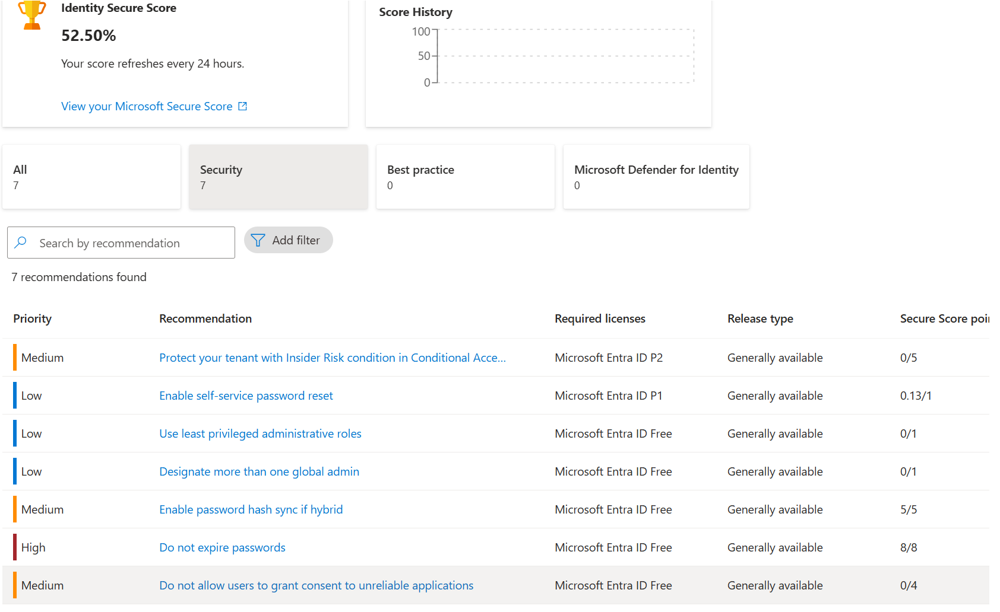

## Oppsett

### 1. Nødkonto (break-glass)

Opprettet kontoen *Break Glass (nødkonto)* med permanent, aktiv tildeling av Global Administrator. Kontoen er unntatt fra alle Conditional Access-policyer og skal bare brukes i nødstilfeller.

### 2. Policyer

| Policy | Gjelder | Krav | Unntak |
|---|---|---|---|
| CA01 - Krev MFA for alle brukere | Alle brukere, alle ressurser | MFA | Nødkonto |
| CA02 - Blokker eldre autentisering | Alle brukere, eldre klienter (Exchange ActiveSync og andre) | Blokker | Nødkonto |
| CA03 - Blokker innlogging utenfor Norge | Alle brukere, alle steder | Blokker | Nødkonto og plasseringen Norge |
| CA04 - Krev MFA ved risikabel innlogging | Innloggingsrisiko middels eller høy | MFA hver gang | Nødkonto |
| CA05 - Krev passordbytte ved høy brukerrisiko | Brukerrisiko høy | MFA og passordbytte | Nødkonto |

Administratorkontoen er ikke unntatt fra policyene. Navnestandarden `CA01`, `CA02` og så videre gjør det lett å holde oversikt.

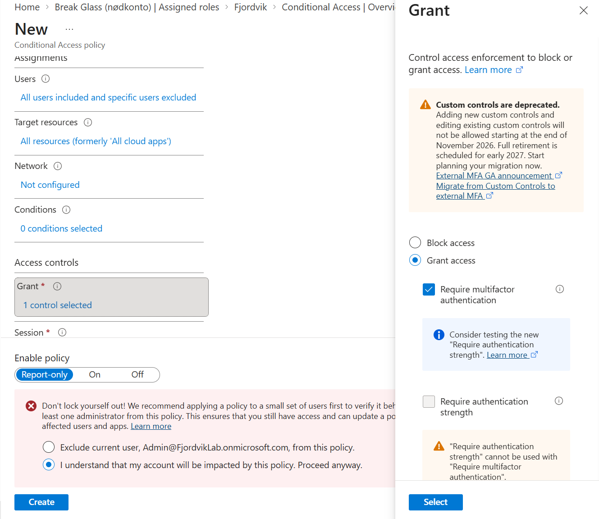

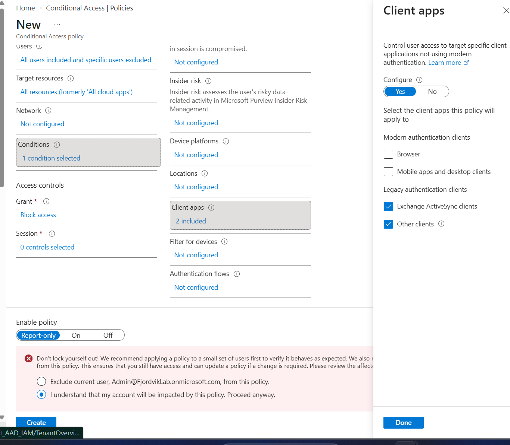

### 3. Report-only, deretter på

Alle policyene ble først satt til report-only, slik at de bare logget hva de ville gjort. Først når resultatet var riktig, ble de slått på.

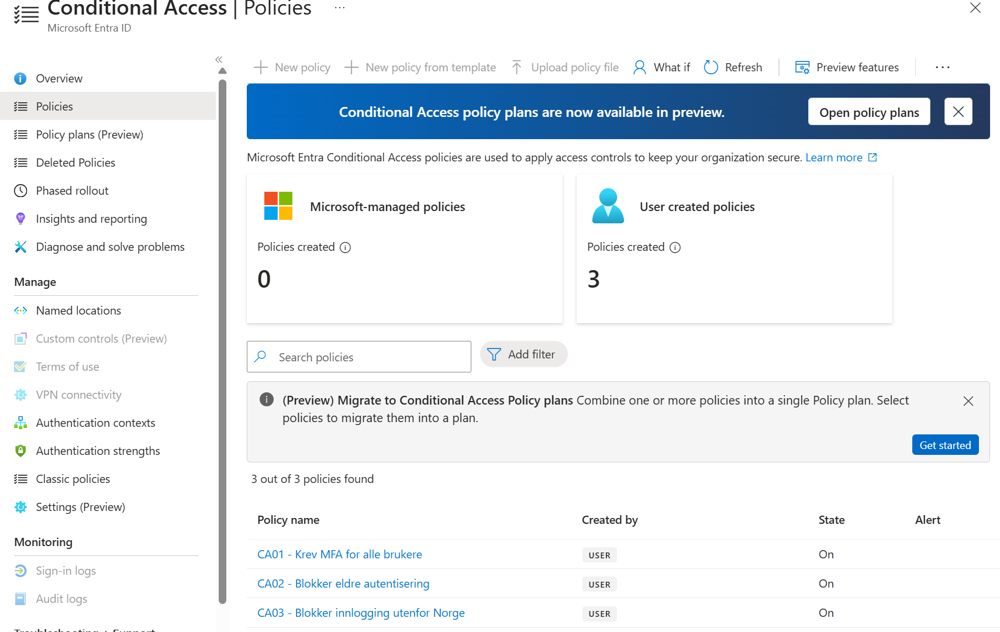

## Tester

| # | Test | Forventet | Resultat |
|---|---|---|---|
| 1 | Anna logger inn fra Norge uten registrert MFA | Må sette opp MFA | Må sette opp MFA |
| 2 | Anna logger inn fra Norge | CA01 krever MFA, CA02 og CA03 gjelder ikke | Som forventet |
| 3 | Innlogging fra USA (What If, IP 8.8.8.8) | CA03 blokkerer | Blokkert |

**Test 1:** CA01 tvinger Anna til å sette opp MFA før hun slipper inn.

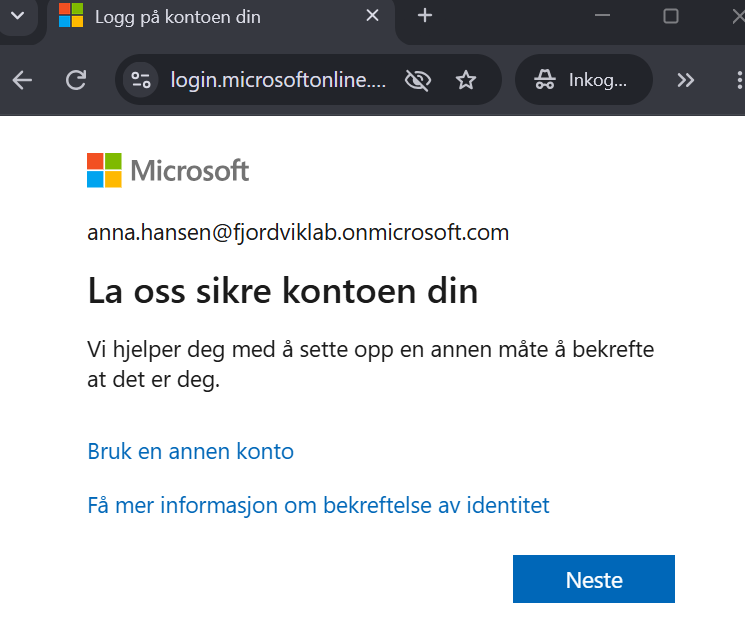

**Test 2:** Sign-in logs viser at CA01 ble håndhevet og at Anna bestod MFA. CA02 og CA03 ble ikke brukt.

**Test 3:** What If viser at en innlogging fra USA blokkeres av CA03.

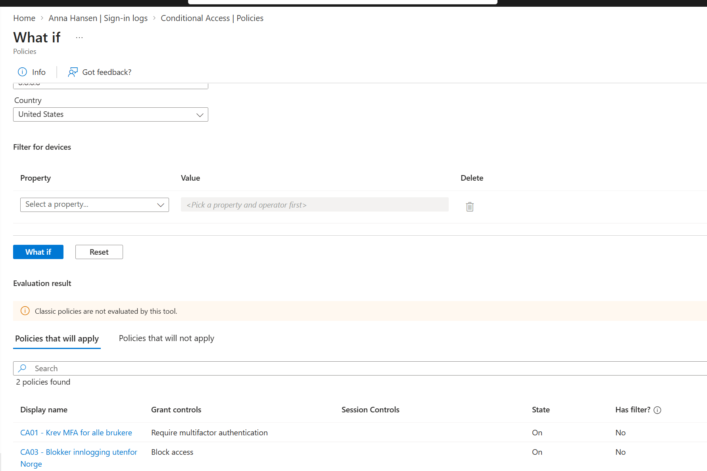

## Funn og forbedring

**Funn 1: CA03 ville blokkert en bruker i Norge.** Den første testen i report-only viste at CA03 ville blokkert Adam, selv om loggen viste at han logget inn fra Norge. Plasseringen Norge og policyen var opprettet bare minutter før innloggingen, og unntaket var ikke tatt i bruk ennå. En ny test 20 minutter senere viste riktig resultat. Hadde policyen blitt slått på med en gang, kunne alle brukerne blitt låst ute.

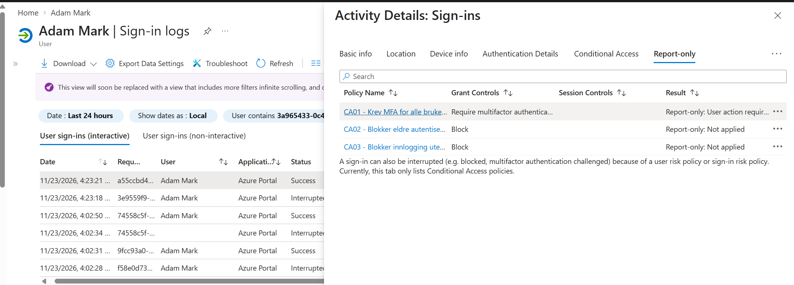

**Lærdom:** Vent etter endringer i policyer og plasseringer, og test på nytt i report-only før policyen slås på.

**Funn 2: MFA ble krevd selv med policyene i report-only.** Microsoft krever alltid MFA ved innlogging på administrasjonsportalene (Azure- og Entra-portalen), uavhengig av egne policyer. For å teste egne policyer riktig ble testene gjort mot myaccount.microsoft.com.

## Risikobaserte policyer (CA04 og CA05)

CA01 til CA03 gjelder alle innlogginger likt. CA04 og CA05 bruker Identity Protection, som vurderer om en innlogging eller en konto ser kompromittert ut.

| | Innloggingsrisiko (CA04) | Brukerrisiko (CA05) |
|---|---|---|
| Spørsmål | Er denne innloggingen mistenkelig? | Er kontoen sannsynligvis kompromittert? |
| Eksempel | Kjent angrepsadresse, umulig reise, Tor | Passordet er funnet i lister over lekkede passord |
| Krav | Ny MFA hver gang, uten lagret godkjenning | MFA og passordbytte |

CA04 er en egen policy og ikke en del av CA01. Betingelser i en policy gjelder samtidig, så en risikobetingelse i CA01 ville fjernet MFA-kravet for vanlige innlogginger. Ny MFA ved hver innlogging gjelder bare risikable innlogginger, for å unngå MFA-tretthet.

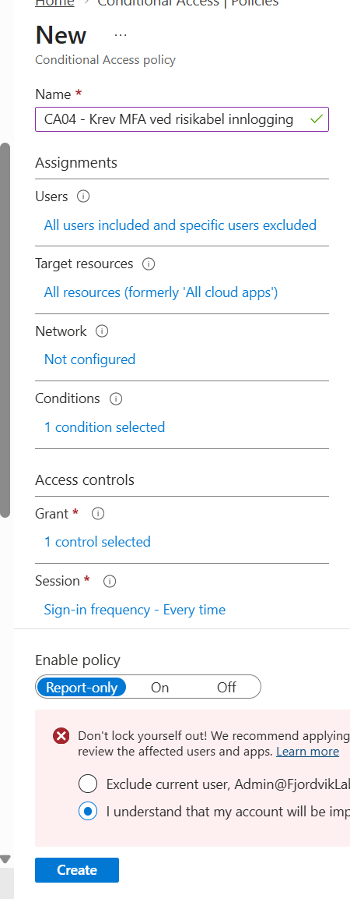

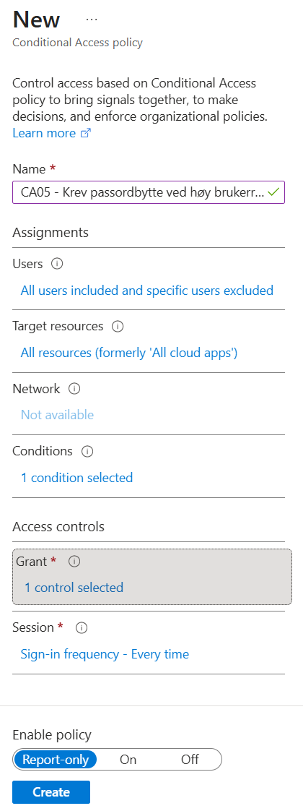

**Test:** En ekte risikabel innlogging kan ikke lages i labben, så policyene er testet med What If: Anna, innlogging fra Norge i nettleser, med innloggingsrisiko og brukerrisiko satt til høy. CA01, CA04 og CA05 slår til. CA02 og CA03 slår ikke til.

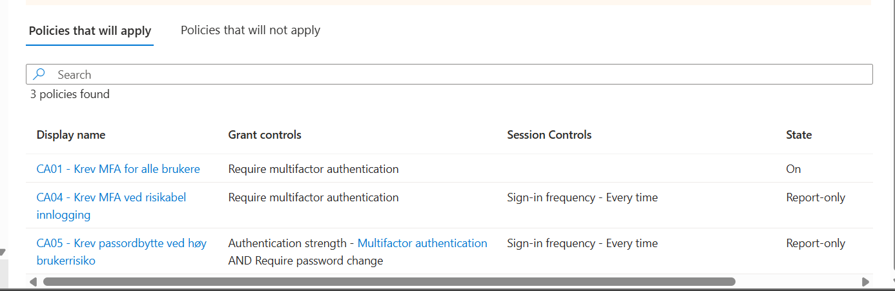

Policyene er slått på. De påvirker bare innlogginger der Identity Protection oppdager risiko.

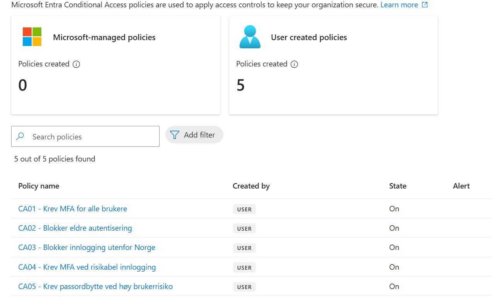

## Resultat i Secure Score

| Tidspunkt | Identity Secure Score | Forklaring |
|---|---|---|
| Før | 52,50 % | Security defaults ga poeng for MFA og blokkering av eldre autentisering |
| Mellom | 21,38 % | Security defaults var slått av, men policyene var ikke tatt med i utregningen ennå |
| Etter CA01-CA03 | 53,37 % | Conditional Access, nødkonto og blokkert brukersamtykke er tatt med |
| Etter CA04 og CA05 | **75,42 %** | De risikobaserte policyene er tatt med |

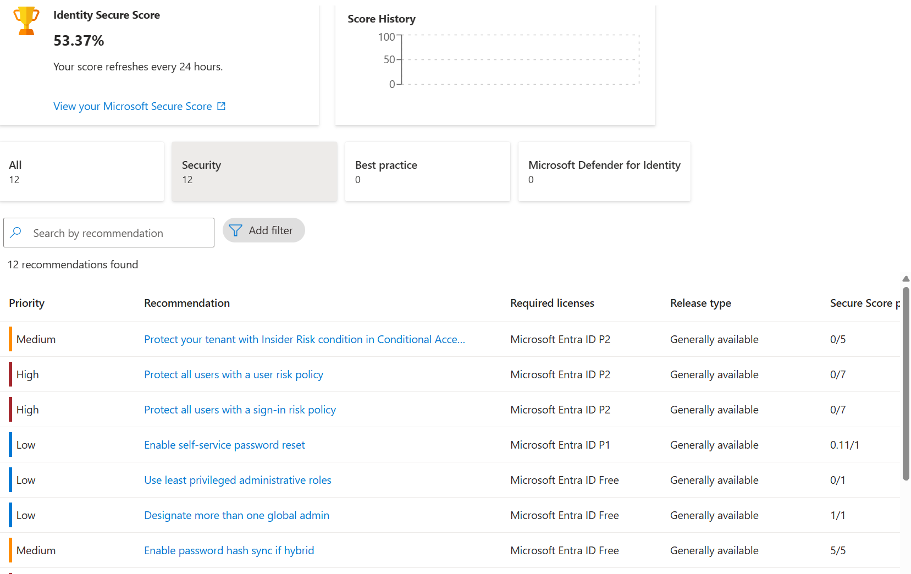

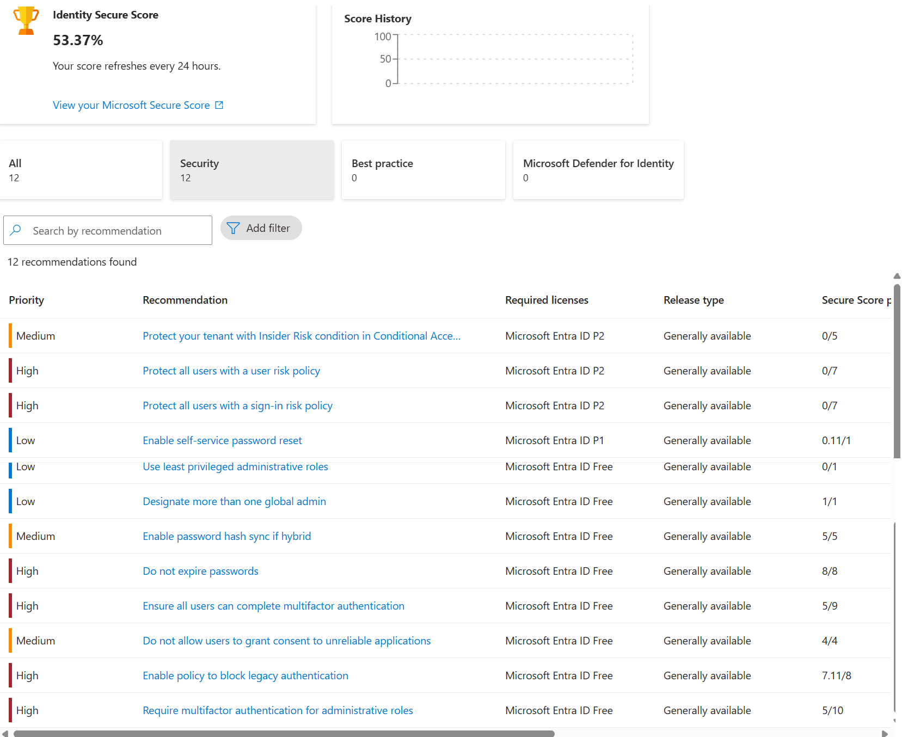

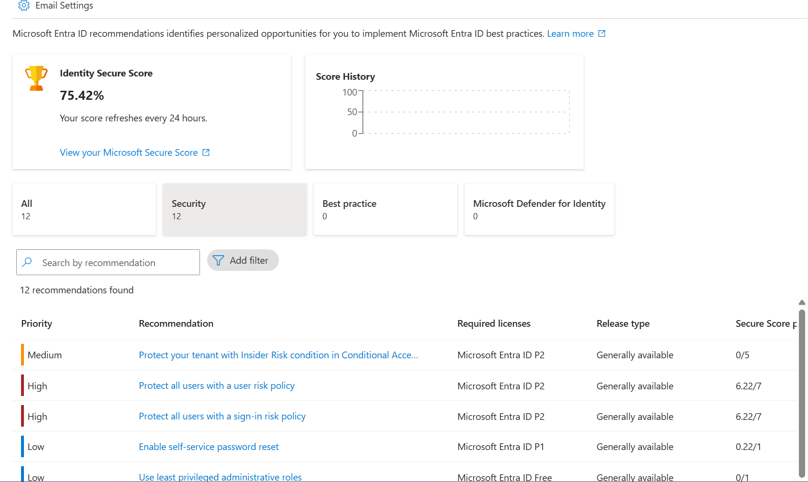

I tillegg til policyene slo jeg av at brukere selv kan gi apper tilgang til data (brukersamtykke). Det beskytter mot consent phishing, der en angriper får tilgang gjennom en falsk app i stedet for å stjele passordet. Anbefalingen gir nå 4 av 4 poeng.

| Anbefaling | Poeng til slutt |
|---|---|
| Protect all users with a user risk policy | 6,22/7 |
| Protect all users with a sign-in risk policy | 6,22/7 |
| Ensure all users can complete multifactor authentication | 7/9 |
| Do not allow users to grant consent to unreliable applications | 4/4 |
| Designate more than one global admin | 1/1 |
| Enable policy to block legacy authentication | 7,11/8 |
| Require multifactor authentication for administrative roles | 5/10 |

**Funn 3: Nødkontoen koster poeng.** Tenanten har to Global Administrator-kontoer, og nødkontoen er unntatt fra alle policyene. Secure Score regner den derfor som ubeskyttet, og ingen av policyene gir fullt antall poeng. Det er et bevisst valg: Uten nødkontoen kan alle administratorer bli låst ute hvis en policy eller MFA feiler.

**Lærdom:** Secure Score er et verktøy, ikke et mål. Å erstatte Security defaults med CA01-CA03 ga omtrent samme poengsum, men mer kontroll: unntak, testing i report-only og blokkering av land. Det store hoppet kom først med de risikobaserte policyene, som Security defaults ikke har.

## Begrensninger

- CA02 er ikke testet med en ekte eldre klient. Den er kontrollert gjennom konfigurasjonen og report-only.
- CA03 er testet med What If, ikke med en ekte innlogging fra utlandet.
- CA04 og CA05 er testet med What If, ikke med en ekte risikabel innlogging.
- Nødkontoen er bare beskyttet av passordet sitt. Bruk av kontoen bør overvåkes med varsling.
- "Ensure all users can complete multifactor authentication" gir 7 av 9 poeng, fordi ikke alle testbrukerne har registrert MFA.
