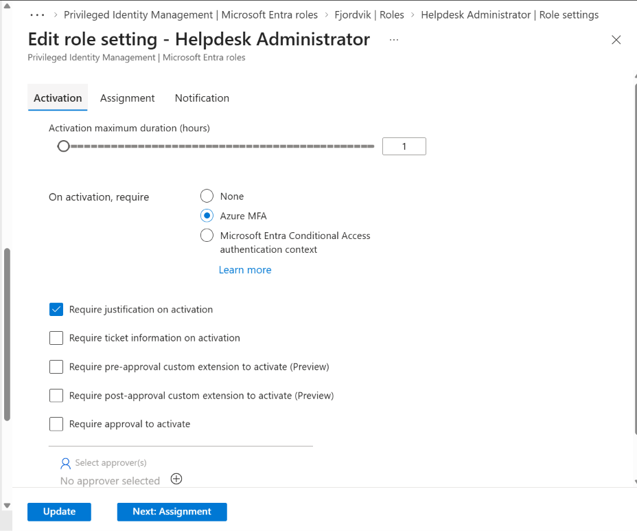
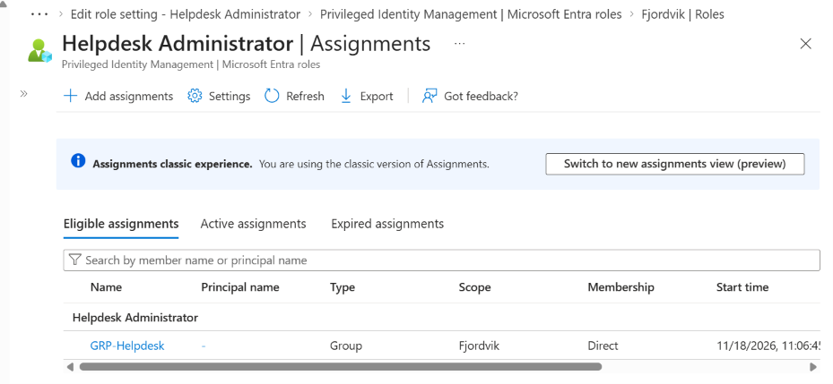
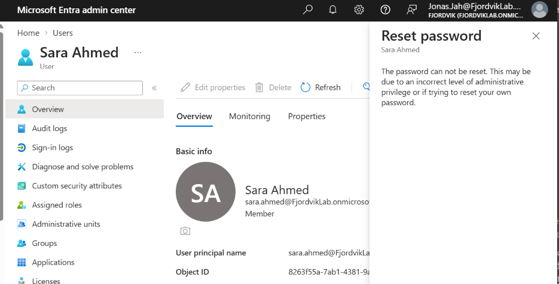
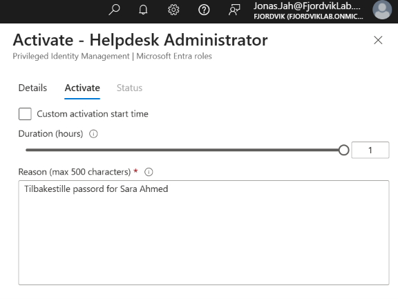
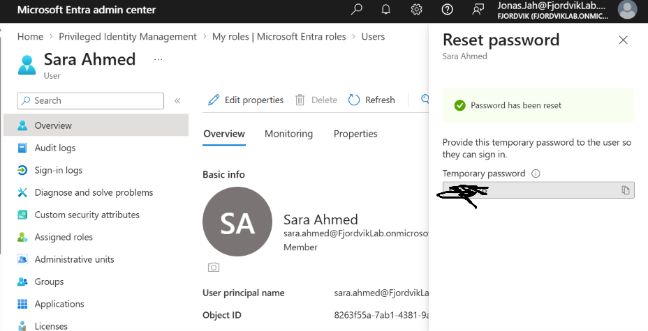
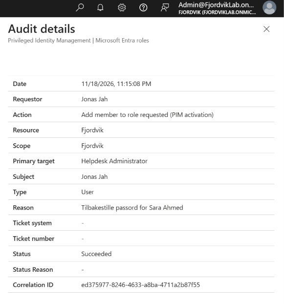

# Modul 5 – PAM: admin-rettigheter bare ved behov

**Behov:** I modul 1 fikk Jonas rollen Helpdesk Administrator permanent gjennom GRP-Helpdesk. Han hadde admin-rettigheter hele døgnet, også når han ikke trengte dem. Hvis kontoen hans ble kompromittert, ville en angriper fått de samme rettighetene.

**Løsning:** Med Privileged Identity Management (PIM) er tildelingen gjort om fra *aktiv* til *kvalifisert* (eligible). Jonas må selv aktivere rollen når han trenger den, og den utløper automatisk etter en time (just-in-time-tilgang).

## Oppsett

1. Satte krav for aktivering av Helpdesk Administrator:
   - Maks varighet: 1 time
   - Krav om MFA ved aktivering
   - Krav om begrunnelse

2. Fjernet den aktive tildelingen av rollen til GRP-Helpdesk, og la den til på nytt som permanent kvalifisert

## Tester

| # | Situasjon | Handling | Forventet | Resultat |
|---|---|---|---|---|
| 1 | Jonas har ikke aktivert rollen | Tilbakestille passordet til Sara | Avvist | Avvist |
| 2 | Jonas aktiverer rollen med MFA og begrunnelse | Aktivering i PIM | Tillatt | Tillatt |
| 3 | Rollen er aktivert | Tilbakestille passordet til Sara | Tillatt | Tillatt |

**Test 1:** Jonas er fortsatt medlem av GRP-Helpdesk, men blir avvist fordi rollen ikke er aktivert.

**Test 2:** Jonas aktiverer rollen i en time og oppgir begrunnelse.

**Test 3:** Etter aktiveringen får Jonas tilbakestille passordet. Det midlertidige passordet er sladdet.

## Sporbarhet

Resource audit i PIM viser hvem som aktiverte rollen, når, og begrunnelsen som ble oppgitt.

## Begrensninger

- Aktivering krever ikke godkjenning. For mer kritiske roller bør en annen administrator godkjenne aktiveringen (fire-øyne-prinsippet).
- Felt for saksnummer (ticket) er ikke tatt i bruk. I en ekte bedrift kan det kobles til en sak i et saksbehandlingssystem.
- Min egen administratorkonto er fortsatt permanent Global Administrator. Den bør også håndteres med PIM, med en egen nødkonto (break-glass) som unntak.
